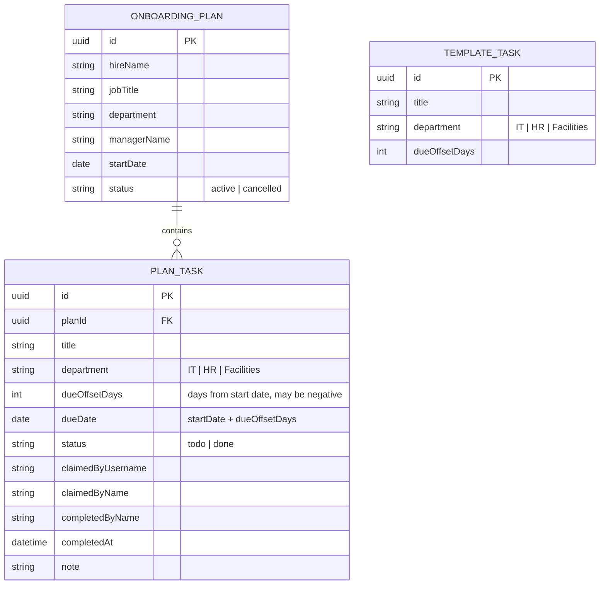

# Domain model

An onboarding plan is one new hire's checklist. Its tasks are copied from the standard template when the plan is created and belong to one department each.

- A template task is copied into each new plan; later template edits never change existing plans.
- Overdue is not stored: a task is overdue when it is `todo`, its plan is `active` and its due date is before today.